# Функции магазина

Функции описаны в порядке, в котором их проходит покупатель: от первого экрана до отказа от покупки. Под каждым
разделом указаны файлы, где это реализовано. Все пути даны от корня репозитория.

- [Главная](#главная)
- [Каталог и фильтры](#каталог-и-фильтры)
- [Поиск](#поиск)
- [Карточка товара](#карточка-товара)
- [Подбор товара и калькулятор дозировки](#подбор-товара-и-калькулятор-дозировки)
- [Корзина](#корзина)
- [Оформление заказа](#оформление-заказа)
- [Заказы и отслеживание](#заказы-и-отслеживание)
- [Отказ от договора](#отказ-от-договора)
- [Избранное, сравнение, недавно просмотренные](#избранное-сравнение-недавно-просмотренные)
- [Отзывы](#отзывы)
- [Лабораторные отчёты](#лабораторные-отчёты)
- [Языки](#языки)
- [Возраст, cookies, рассылка](#возраст-cookies-рассылка)

---

## Главная

На первом экране: заголовок, две кнопки (каталог и подбор товара) и четыре факта доверия. Средний рейтинг и число
отзывов в четвёртом факте считаются по данным каталога, они не прописаны в коде вручную. Фоновая фотография
загружается с высоким приоритетом, потому что это главный элемент для метрики LCP.

Дальше по странице идут:
- чипы категорий;
- бестселлеры;
- витрина из шести категорий с фотографиями;
- редакционный блок «In focus» об одном товаре, без таймеров и скидочных плашек;
- преимущества и новинки;
- калькулятор дозировки;
- «Как это работает» и блок о лабораторных сертификатах;
- отзывы, FAQ, подписка;
- недавно просмотренные товары.

| Категории | In focus | Лаборатория |
|---|---|---|
| 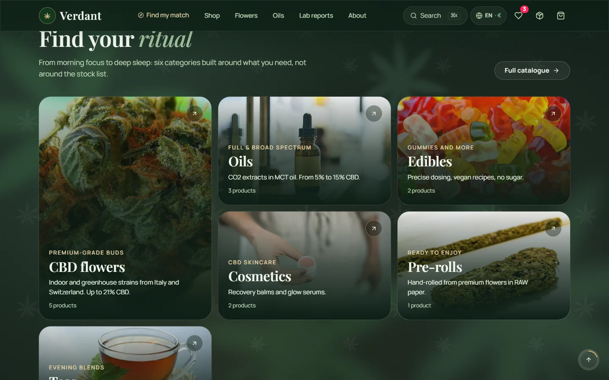 | 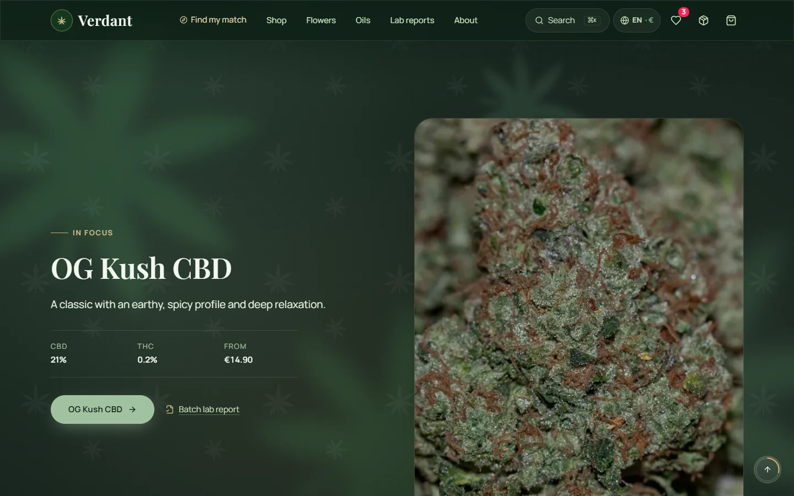 | 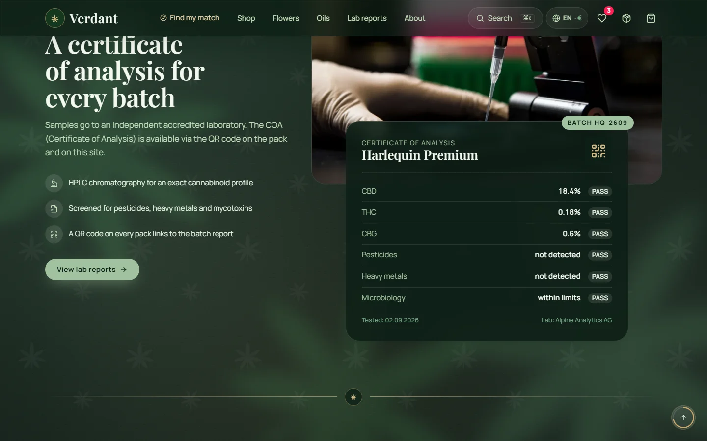 |

Код: `apps/web/src/pages/home`, виджеты `hero`, `category-showcase`, `promo-banner`, `lab-trust`.

## Каталог и фильтры

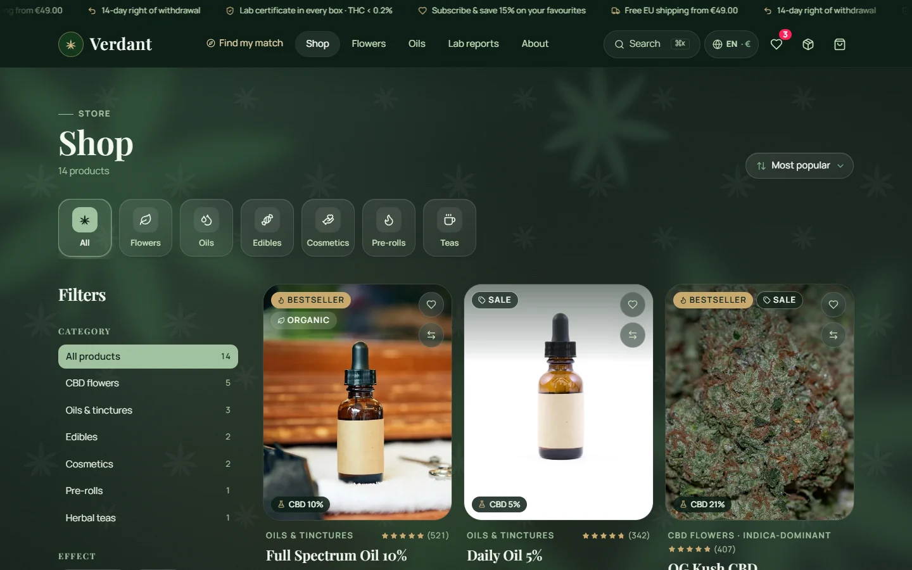

Каталог фильтрует товары по категории, эффекту, отметке («бестселлер», «новинка», «скидка»), диапазону цены,
минимальному содержанию CBD и наличию. Сортировок шесть: по популярности, по цене в обе стороны, по рейтингу, по
новизне и по CBD.

Всё состояние фильтров хранится в адресной строке. Отфильтрованной выдачей можно поделиться ссылкой, а кнопка
«Назад» в браузере работает предсказуемо. На десктопе фильтры стоят в боковой панели, на телефоне открываются
шторкой. У каждой категории показано число товаров.

Карточка товара в сетке содержит фото, категорию, рейтинг, название, короткое описание и цену. Если цена снижена,
под ней указана минимальная цена за 30 дней до снижения. Кнопки «в избранное», «сравнить» и «быстрый просмотр»
лежат поверх фото. На десктопе кнопка «в корзину» появляется при наведении, на телефоне она видна всегда.

Код: `apps/web/src/pages/catalog`, `features/product-filters`, `entities/product/ui/ProductCard.tsx`, фильтрация
`packages/shared/src/filters.ts`.

## Поиск

| Сервисный запрос | Опечатка |
|---|---|
| 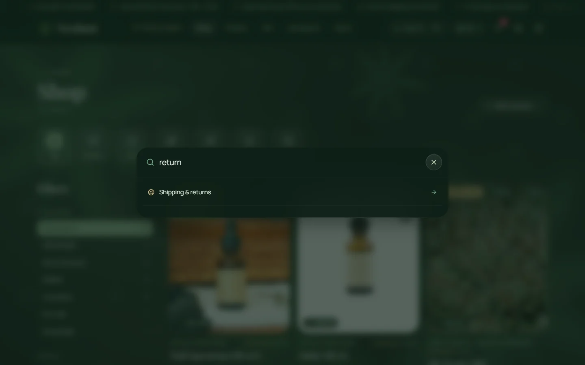 | 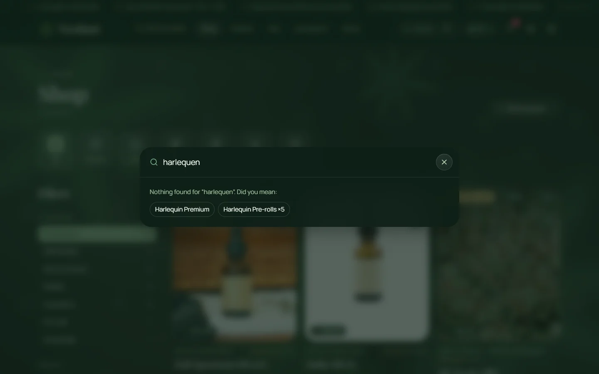 |

Поиск открывается по `Ctrl/⌘ + K` или кнопкой в шапке. Он ищет по названию, сорту, описанию, аромату, терпенам и по
переводам на все три языка, без учёта регистра и диакритики (ß считается как ss).

На сайтах магазинов чаще всего ломаются два типа запросов, и оба здесь обработаны:

- **Запросы не о товарах.** «return», «Rücksendung», «where is my order», «certificate», «contact» ведут на нужные
  страницы сервиса. Ключевые слова заданы на трёх языках.
- **Опечатки.** Если по запросу ничего не нашлось, поиск предлагает товары, чьё название отличается на одну-две буквы
  (расстояние Левенштейна).

Код: `apps/web/src/features/product-search` (`model/help.ts` — сервисные ссылки и исправление опечаток).

## Карточка товара

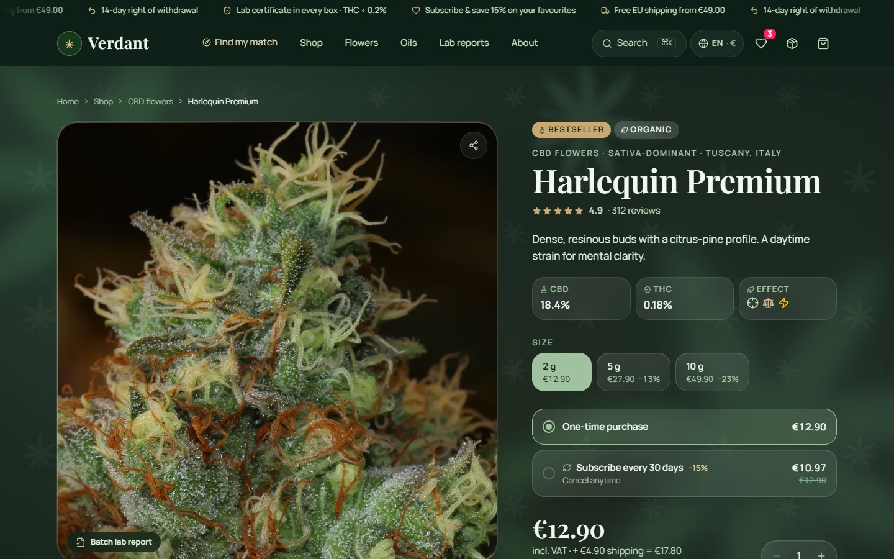

Слева галерея: фото и три крупных плана, ссылка на лабораторный отчёт партии и кнопка «поделиться». Справа панель
покупки, где собрано всё нужное для решения:

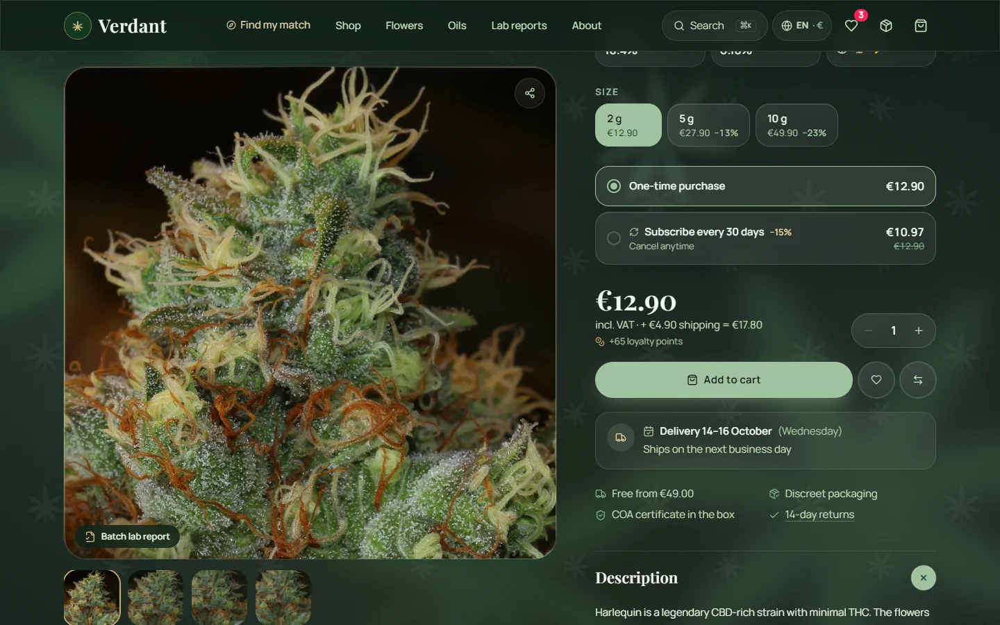

- **Фасовка** выбирается кнопками, а не выпадающим списком. На каждой видна цена и выгода за единицу.
- **Разовая покупка или подписка** раз в 30 дней со скидкой 15%.
- **Полная стоимость:** «incl. VAT · + €4.90 shipping = €17.80», при сумме от 49 € — «бесплатная доставка».
- **Дата доставки** указана конкретными днями, а не «2–4 дня». Если до 15:00 в рабочий день ещё есть время,
  показывается обратный отсчёт до отправки сегодня. Это настоящее время отсечки, а не искусственная срочность.
- **Остаток** показывается спокойным текстом, только если товара осталось 8 штук или меньше.
- **Условия возврата** доступны по ссылке прямо в панели.

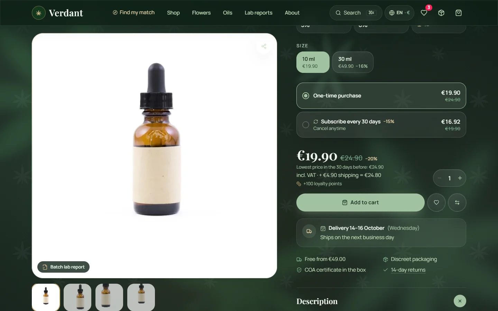

Скидка показывается вместе с минимальной ценой за 30 дней до снижения. API вычисляет эту цену из истории цен и
отдаёт зачёркнутую цену только при реальном снижении (подробно в [COMPLIANCE.md](COMPLIANCE.md)).

Ниже панели: аккордеон (описание, профиль и терпены, применение, доставка), набор «часто покупают вместе» со скидкой
10%, отзывы, похожие товары, недавно просмотренные. На телефоне при прокрутке появляется закреплённая панель с ценой
и кнопкой «Купить». Для поисковиков страница отдаёт разметку schema.org `Product` с фото, рейтингом и ценами.

Код: `apps/web/src/pages/product`, виджеты `product-purchase`, `delivery-estimate`, `bundle-offer`, компоненты
`entities/product/ui/Price.tsx` и `ProductVisual.tsx`.

## Подбор товара и калькулятор дозировки

| Тест подбора | Мобильная версия |
|---|---|
| 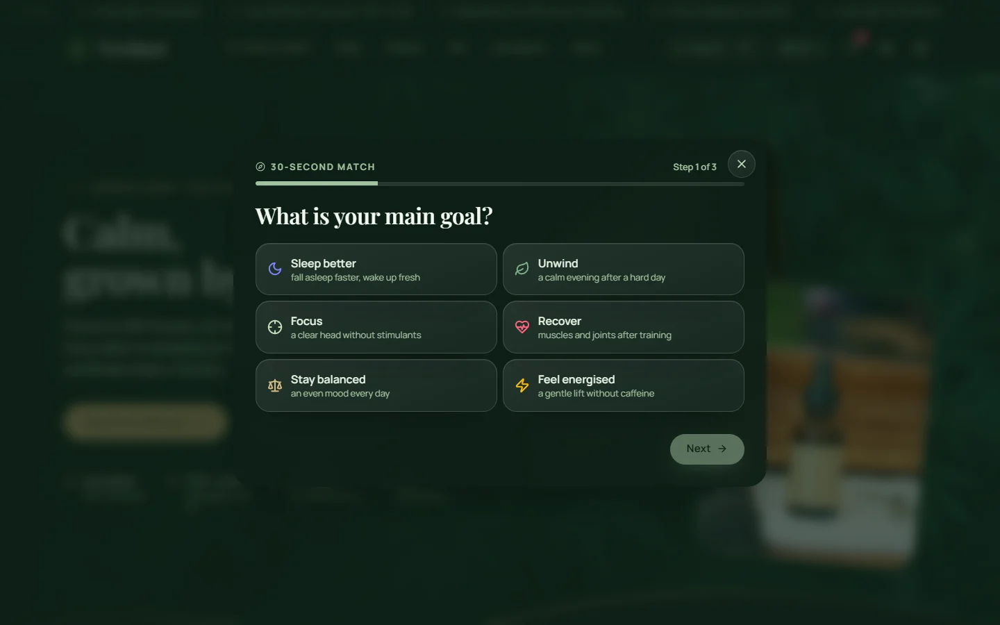 | 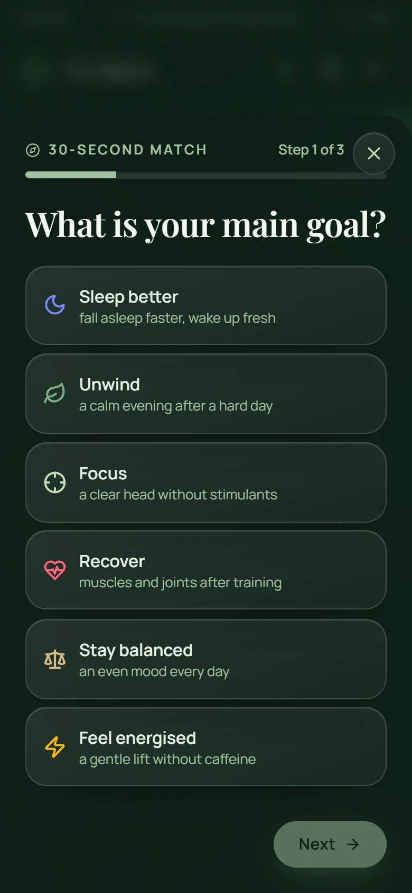 |

**Тест** из трёх вопросов (цель, формат, опыт) возвращает три лучших товара. Расчёт идёт в браузере, данные никуда
не отправляются: покупатель сам сообщает предпочтения. Тест открывается из шапки, с главного экрана и кнопкой «Match»
в нижней панели на телефоне.

**Калькулятор дозировки** на главной считает стартовую дозу по весу, цели и опыту и переводит её в капли для масел 5%
и 10%. На нём есть пометка, что это не медицинская рекомендация.

Код: `features/product-quiz`, `features/dose-calculator`.

## Корзина

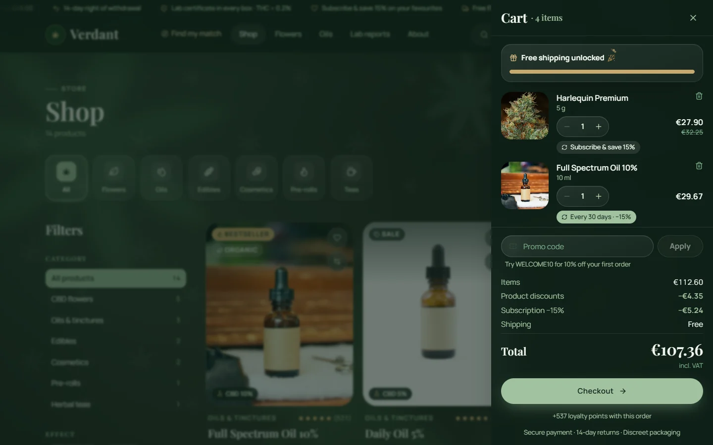

Корзина открывается боковой шторкой с любой страницы, есть и отдельная страница `/cart`. В ней можно:
- менять количество в пределах остатка;
- включить подписку для отдельной позиции;
- ввести промокод.

Шкала показывает, сколько осталось до бесплатной доставки. В итогах отдельно видны скидки на товары, подписка,
промокод и доставка. Корзина хранится в браузере и переживает перезагрузку.

Код: `widgets/cart-drawer`, `pages/cart`, `entities/cart`, расчёт `packages/shared/src/pricing.ts`.

## Оформление заказа

| Десктоп | Мобильная версия |
|---|---|
| 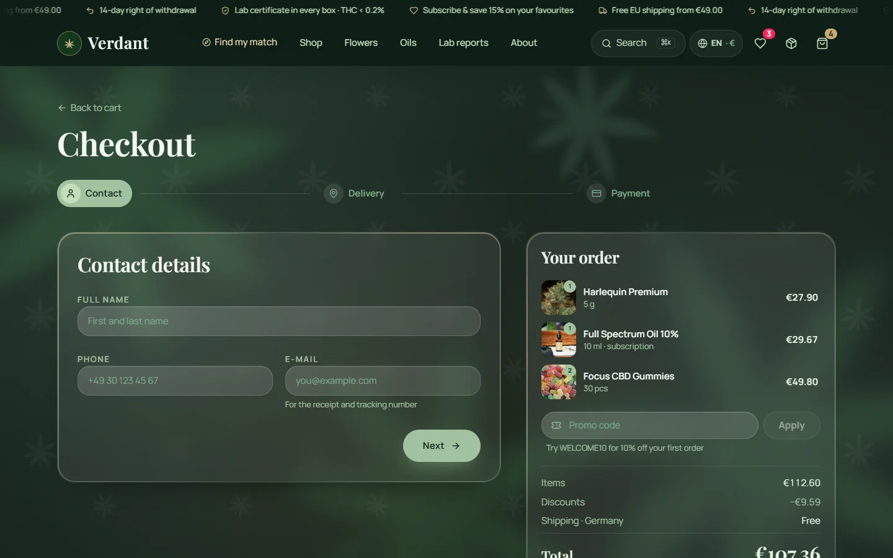 | 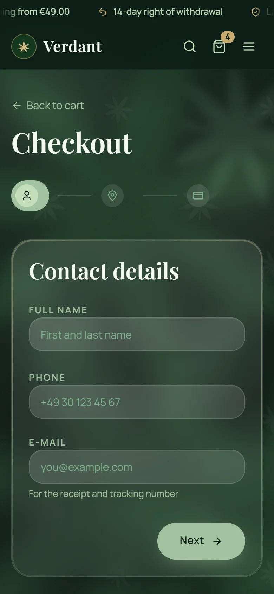 |

Оформление идёт в три шага: контакты, доставка, оплата. Сводка заказа всё время видна сбоку.

- **Доставка.** 27 стран ЕС в двух тарифных зонах; три способа: стандартная, экспресс и постамат, с ценой и сроком
  для выбранной страны. Если в корзине цветки или самокрутки, а страна ограничивает их дистанционную продажу,
  появляется предупреждение и следующий шаг блокируется.
- **Оплата.** На выбор карта, PayPal, Apple/Google Pay, SEPA и Klarna. Обязательны отметки «мне 18+» и согласие с
  условиями.
- **Отправка.** Форма проверяется той же zod-схемой, что и на сервере. Сервер заново считает цены, проверяет остаток
  и ограничения по стране и создаёт заказ.

Платёжный провайдер не подключён: заказ создаётся сразу (см. [DEMO-NOTES.md](DEMO-NOTES.md)).

Код: `apps/web/src/pages/checkout`, `apps/api/src/routes/orders.ts`, схемы `packages/shared/src/schemas.ts`.

## Заказы и отслеживание

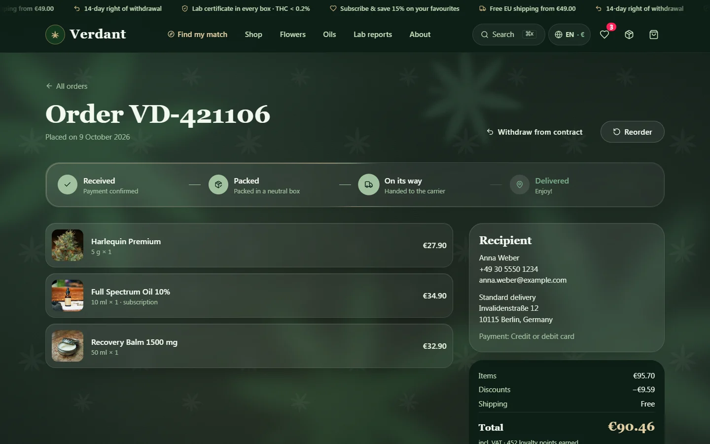

Страница «Мои заказы» показывает заказы, оформленные в этом браузере, и баланс бонусных баллов (5% от суммы). На
странице заказа есть шкала статуса, состав, получатель, итоги, кнопка «Повторить заказ» и кнопка «Отказаться от
договора», пока не истёк срок. Статус обновляется каждые 30 секунд. В демо он продвигается сам с возрастом заказа.

Код: `pages/orders`, `pages/order`, `entities/order`.

## Отказ от договора

| Шаг 1: найти заказ | Шаг 2: подтвердить |
|---|---|
| 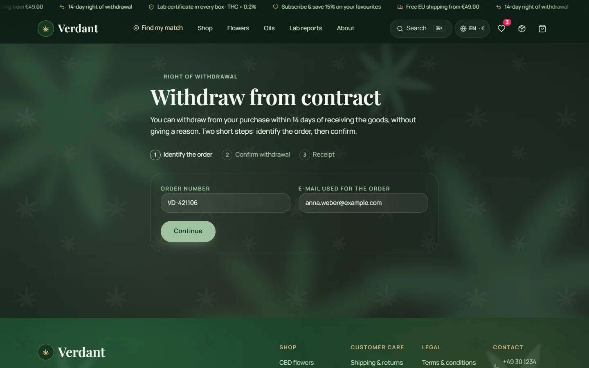 | 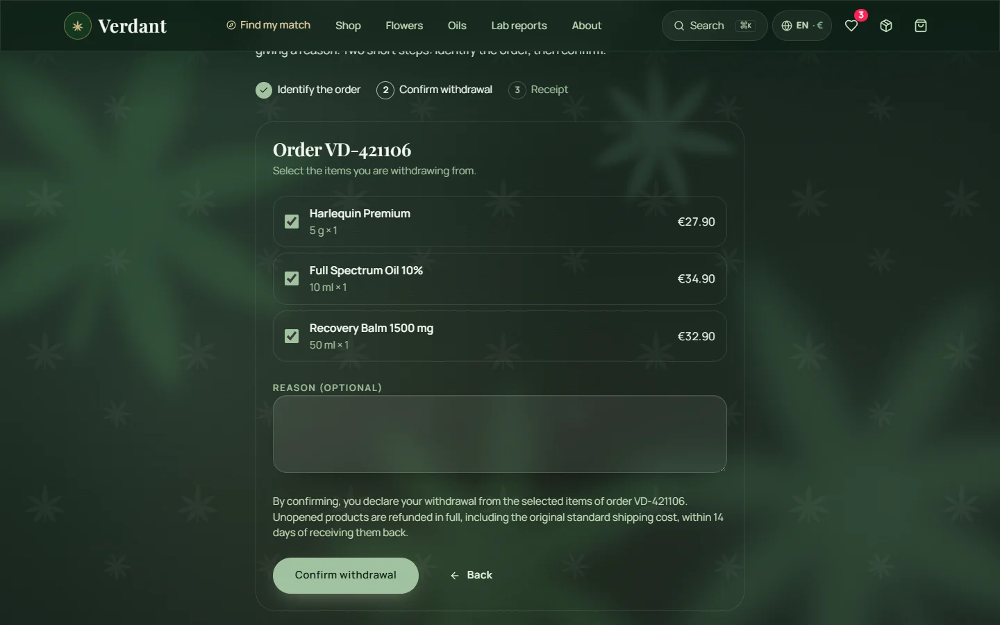 |

Это реализация «кнопки отказа» по директиве (ЕС) 2023/2673. Ссылки «Withdraw from contract» есть в подвале сайта и на
странице заказа. Порядок такой:
1. Покупатель указывает номер заказа и email.
2. Выбирает товары: можно все или только часть.
3. При желании указывает причину.
4. Нажимает отдельную кнопку «Confirm withdrawal».

После этого он получает квитанцию с номером, датой и временем, которую можно распечатать. На странице заказа появляется
отметка о принятом отказе. По-немецки кнопки называются «Vertrag widerrufen» и «Widerruf bestätigen».

Код: `apps/web/src/pages/withdrawal`, `apps/api/src/routes/withdrawals.ts`, модель `Withdrawal` в Prisma.

## Избранное, сравнение, недавно просмотренные

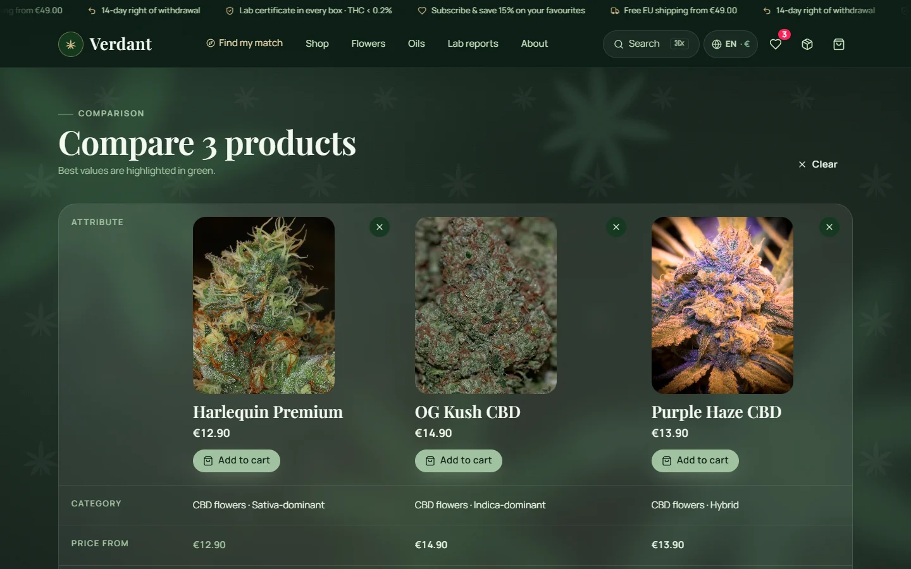

- **Избранное** хранится в браузере, счётчик виден в шапке.
- **Сравнение** до трёх товаров: таблица цен, цены за единицу, CBD/THC, эффектов, терпенов, аромата, рейтинга,
  происхождения, фасовок и наличия, лучшие значения подсвечены. Пока товары выбраны, внизу экрана висит панель
  сравнения.
- **Недавно просмотренные** — до восьми последних товаров.

Код: `pages/wishlist`, `pages/compare`, `entities/wishlist`, `entities/compare`, `widgets/recently-viewed`.

## Отзывы

На странице товара отзывы собраны в сводку с распределением оценок. Их можно сортировать и фильтровать, отмечать
«полезно» и оставлять свои. Форма проверяется на клиенте и сервере, а рейтинг товара после нового отзыва
пересчитывается. Все сид-отзывы вымышлены (см. [DEMO-NOTES.md](DEMO-NOTES.md)).

Код: `widgets/product-reviews`, `features/write-review`, `apps/api/src/routes/reviews.ts`.

## Лабораторные отчёты

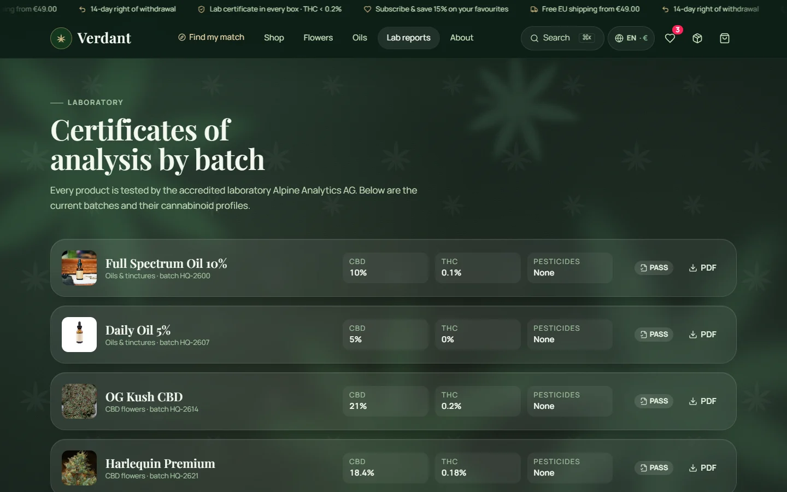

Страница `/lab-results` показывает по строке на каждый товар: номер партии, CBD, THC, пестициды и отметку о
соответствии. Ссылка «Batch lab report» с карточки товара ведёт к нужной строке и подсвечивает её. Лаборатория и
результаты вымышлены, скачивание PDF не подключено.

## Языки

Интерфейс переведён на английский, немецкий и французский: около 670 строк на каждый язык. Описания товаров
переводятся на сервере. Язык определяется по браузеру и переключается в шапке. Цены и даты форматируются по локали
(`en-IE`, `de-DE`, `fr-FR`). Словари загружаются только для выбранного языка, поэтому английский посетитель их
не скачивает.

Код: `apps/web/src/shared/i18n`, `apps/api/src/lib/locale.ts`.

## Возраст, cookies, рассылка

- **Подтверждение возраста** — блокирующее окно «Вам есть 18?» при первом визите. При оформлении заказа возраст
  подтверждается ещё раз отметкой.
- **Cookies.** Баннер с тремя равноценными кнопками: принять все, только необходимые, настроить. Выбор можно сбросить
  на странице `/legal/cookies`. Аналитики в проекте нет, так что согласие ничего не включает: баннер показывает, как
  это должно работать.
- **Рассылка.** Форма подписки возвращает приветственный промокод `WELCOME10`.

Код: `features/age-gate`, `widgets/cookie-consent`, `features/newsletter`.

---

**Мобильная версия.** На телефоне есть нижняя панель (Главная, Магазин, Подбор, Избранное, Заказы), полноэкранное меню
с категориями и выбором языка, поиск в нижней шторке, закреплённая кнопка покупки и шторка фильтров. Все экраны:
[SCREENSHOTS.md](SCREENSHOTS.md#мобильная-версия).
