# Скриншоты

Все экраны сняты с работающего проекта 9 октября 2026 года в Chrome:
- **десктоп** — окно 1440 × 900;
- **мобильная версия** — 390 × 844 (iPhone 14 / 15) с двойной плотностью пикселей.

Язык английский, если не указано иное. Файлы лежат в [`docs/screenshots/`](screenshots).

- [Десктоп](#десктоп)
- [Мобильная версия](#мобильная-версия)
- [Главная целиком](#главная-целиком)

## Десктоп

### Главная

**Первый экран.** Заголовок, кнопки «Shop the collection» и «Find my match», факты доверия (рейтинг считается по
каталогу), фото товаров.


**Бестселлеры.** Сетка карточек: фото, бейджи, рейтинг, цена.

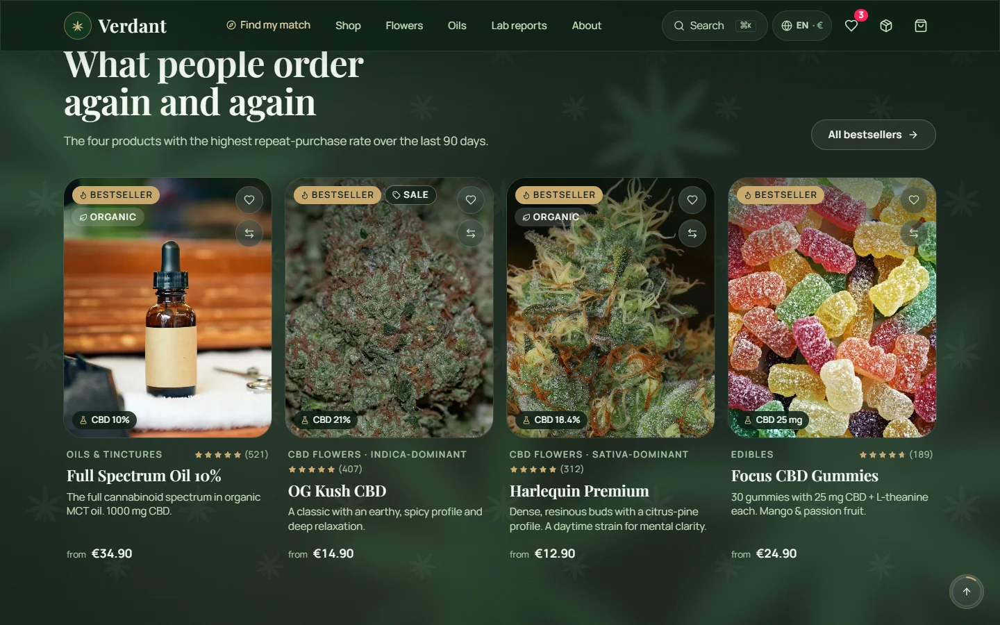

**Категории.** Шесть карточек с фотографиями и числом товаров.


**In focus.** Редакционный блок об одном товаре: только реальные данные, без таймера и скидочной плашки.


**Прозрачность.** Пример сертификата анализа поверх фото лаборатории.


### Каталог и поиск

**Каталог.** Боковая панель фильтров с числом товаров, чипы категорий, сортировка. Скидка показана с минимальной ценой
за 30 дней.


**Поиск, сервисный запрос.** На запрос «return» поиск предлагает страницу «Shipping & returns».


**Поиск, опечатка.** На «harlequen» поиск предлагает «Harlequin Premium» и «Harlequin Pre-rolls ×5».


### Товар

**Карточка товара.** Галерея, ссылка на отчёт партии, рейтинг, CBD/THC/эффект, выбор фасовки, разовая покупка или
подписка.


**Панель покупки.** Полная цена с доставкой, баллы, дата доставки, бесплатная доставка от 49 €, ссылка на условия
возврата.


**Скидка по правилам Omnibus.** €19.90 вместо €24.90, ниже строка «Lowest price in the 30 days before: €24.90».


**Немецкая версия.** Интерфейс, описание товара, цены и даты в формате `de-DE`.


**Сравнение.** Три товара, лучшие значения подсвечены.


**Подбор товара.** Тест из трёх вопросов.


### Покупка

**Корзина.** Бесплатная доставка достигнута, подписка на позицию, промокод, итог с раскладкой скидок.


**Оформление, шаг 1.** Контакты; сбоку сводка заказа.


**Страница заказа.** Шкала статуса, состав, получатель, итоги, кнопки «Withdraw from contract» и «Reorder».


**Отказ от договора, шаг 1.** Номер заказа и email подставлены из ссылки на странице заказа.


**Отказ от договора, шаг 2.** Выбор позиций, причина, отдельная кнопка «Confirm withdrawal».


### Контент

**Лабораторные отчёты.** По строке на товар.


**О нас.** Шапка с фото поля.

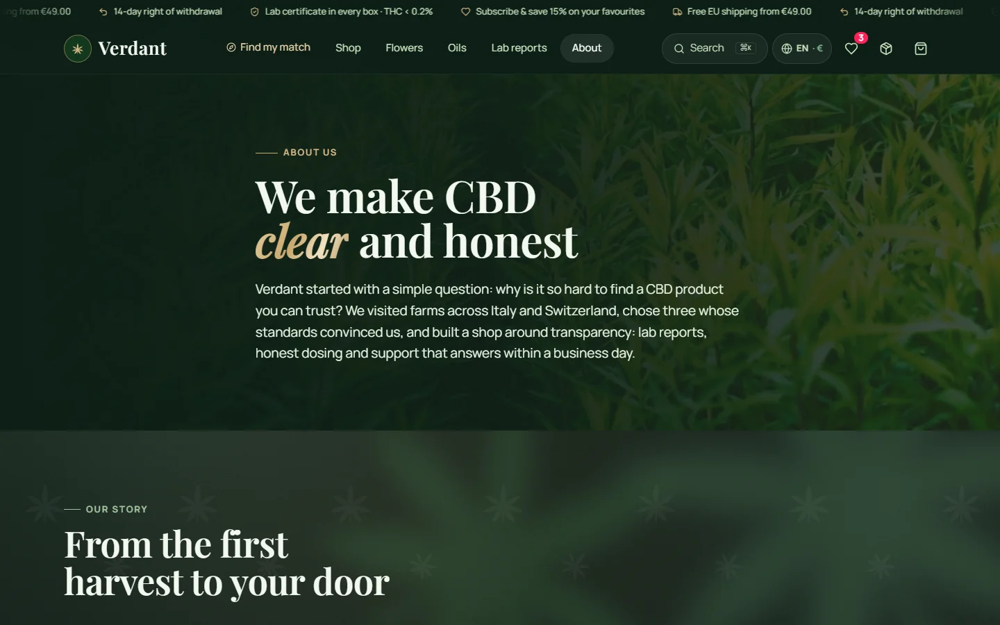

## Мобильная версия

| Главная | Категории | Каталог |
|---|---|---|
| 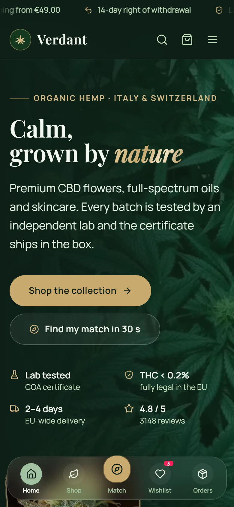 | 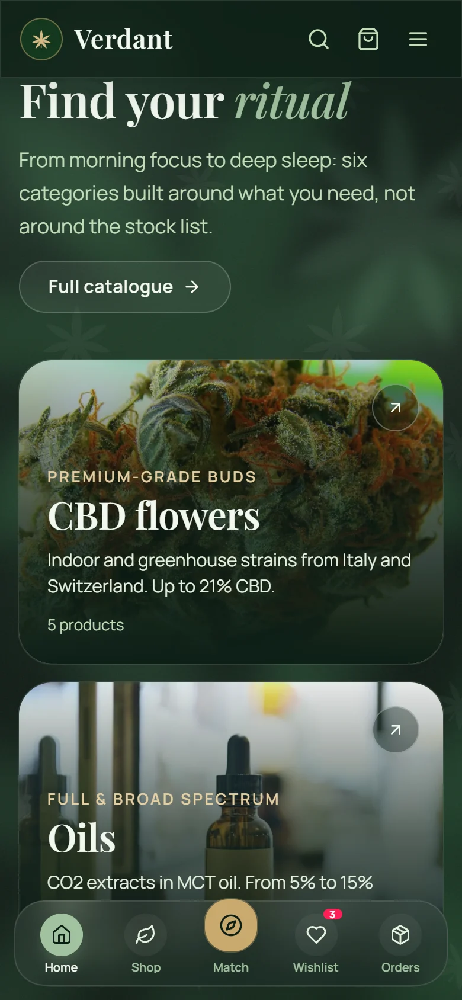 | 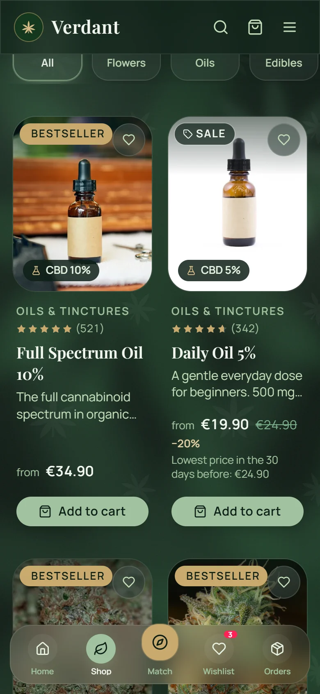 |
| Нижняя панель навигации, кнопка подбора по центру | Карточки категорий с фото | Две колонки, кнопка «в корзину» видна всегда |

| Товар | Панель покупки | Корзина |
|---|---|---|
| 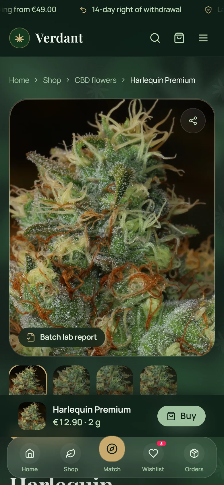 | 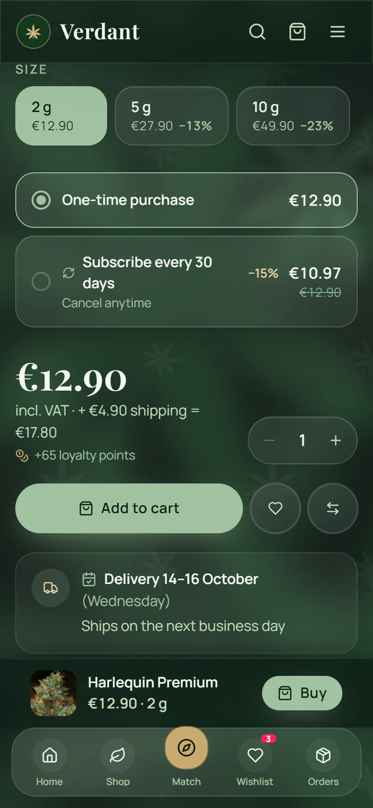 | 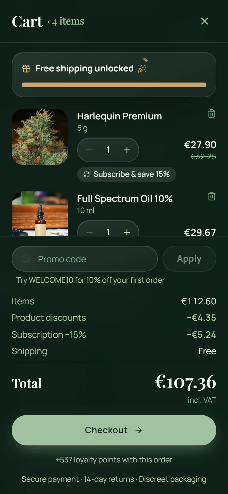 |
| Закреплённая кнопка «Buy» | Фасовка, подписка, полная цена, дата доставки | Шторка на весь экран |

| Оформление | Меню | Поиск |
|---|---|---|
|  | 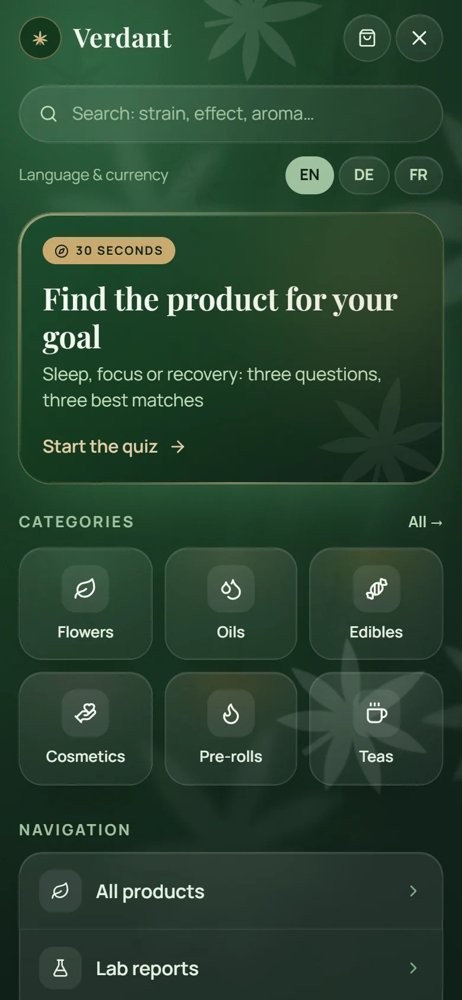 | 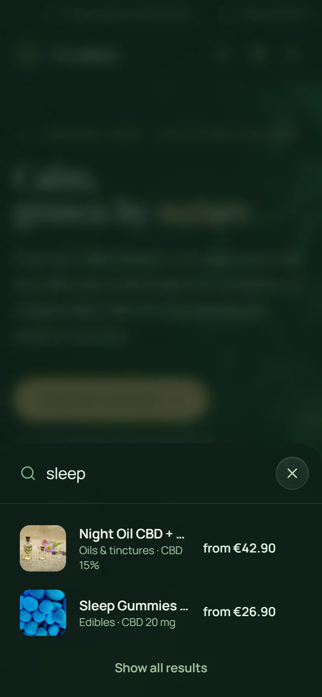 |
| Шаги иконками, крупные поля | Поиск, язык, подбор, категории | Нижняя шторка с результатами |

| Заказ | Отказ от договора | Подбор |
|---|---|---|
| 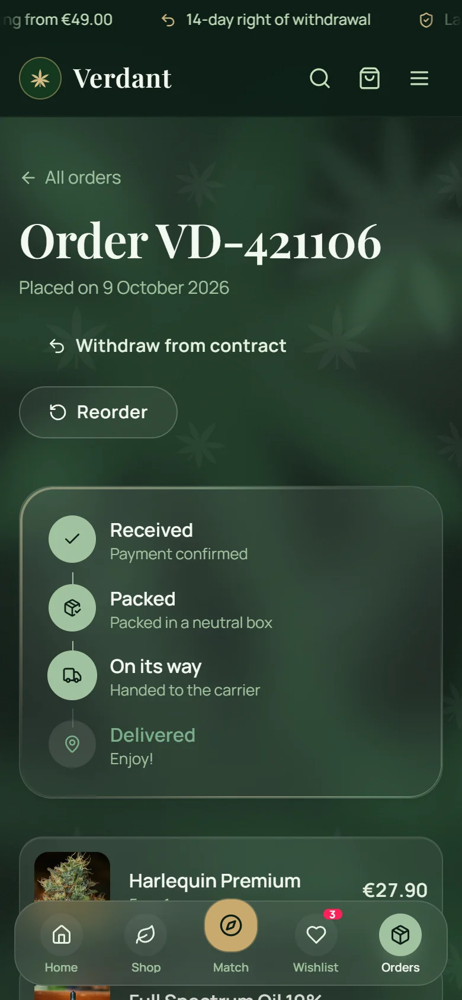 | 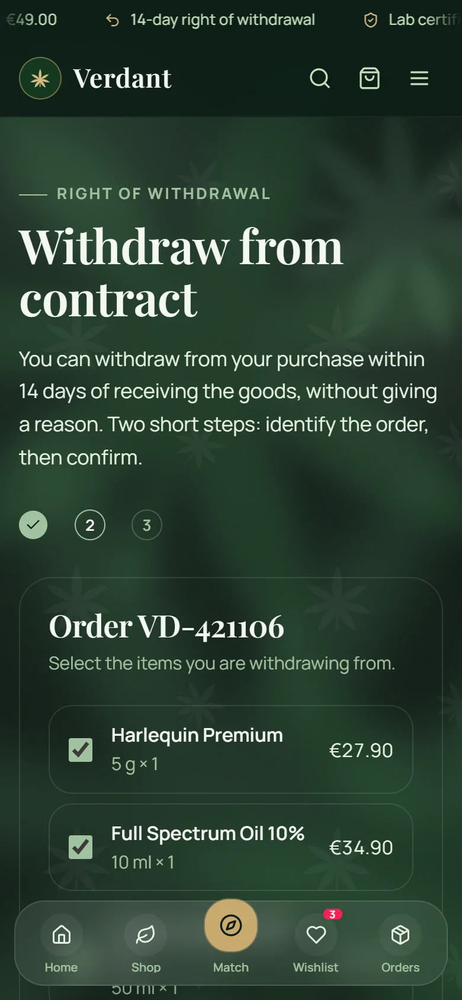 |  |
| Вертикальная шкала статуса | Шаг 2: выбор позиций | Первый вопрос теста |

## Главная целиком

Вся главная страница одним кадром, в масштабе 50%: [`desktop/00-home-full.webp`](screenshots/desktop/00-home-full.webp).

## Как переснять

```bash
npm run dev                         # в отдельном терминале
npm run screenshots                 # все 34 кадра в docs/screenshots
node scripts/capture-screenshots.mjs docs/screenshots mobile/04,desktop/07   # только выбранные
```

Скрипт `scripts/capture-screenshots.mjs` управляет Chrome через DevTools Protocol. Перед каждым кадром он заново
выставляет состояние браузера: возраст подтверждён, решение по cookies принято, заполнены корзина, избранное и
недавно просмотренные. Для экранов заказа и отказа скрипт создаёт через API демонстрационный заказ на имя
Anna Weber; после съёмки его можно удалить командой `npm run db:reset`.

Переменные окружения:
- `BASE_URL` — адрес витрины, по умолчанию `http://localhost:5173`;
- `API_URL` — адрес API, по умолчанию `http://localhost:3001/api`;
- `CHROME` — путь к Chrome.
